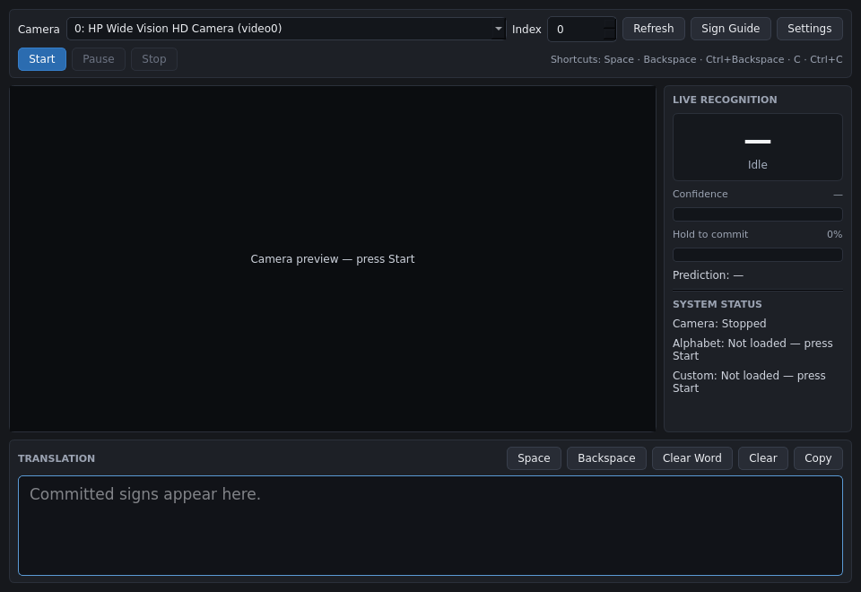
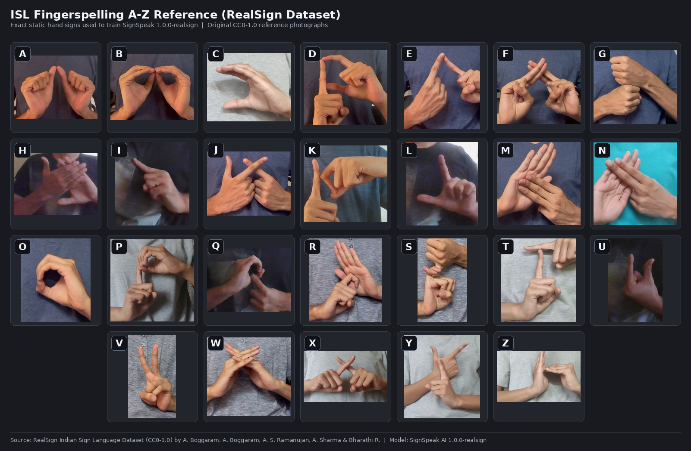

# Sign Language Translator

A native PyQt6 desktop app that turns **isolated, static Indian Sign Language (ISL) fingerspelling A–Z** into text. The alphabet works after installing and verifying the pinned SignSpeak model. The five optional webcam commands need your own validated training samples. Manual text controls work with no camera or model. There is no browser or server to start.



*Native PyQt6 desktop interface (dark theme, before pressing Start; light and system themes also available).*

## Training hand signs (ISL A–Z reference)

The pretrained **SignSpeak `1.0.0-realsign`** alphabet classifier recognizes the **26 static Indian Sign Language (ISL) hand signs** below, taken directly from the official `Letters/A.jpg`–`Letters/Z.jpg` reference photographs of the CC0-1.0 **RealSign Indian Sign Language Dataset** used to train the model. This same reference chart (along with the five optional custom commands) is also built into the app under **Sign Guide** for offline viewing.



*Original CC0-1.0 RealSign dataset reference photographs (A. Boggaram, A. Boggaram, A. S. Ramanujan, A. Sharma & Bharathi R.). For left-handed signing or hardware-mirrored webcams, enable **Settings → Input orientation (Flip input horizontally)** or launch with `--mirror-input`.*

## Quick start

Once the prerequisites are installed, run `& ".\scripts\setup.ps1"` on Windows or `bash scripts/setup.sh` on Linux from the clone. Activate `.venv` as shown below, then run `python app.py`, select a camera and click **Start**. Setup downloads and verifies the alphabet model; the camera does not open at launch. Use the full walkthrough for manual setup or if your shell blocks the helper.

### Windows 10/11 (x64)

Windows is a target platform, not a natively verified combination. Use a regular user account.

1. **Install prerequisites.** Install [Python for Windows](https://www.python.org/downloads/windows/) (64-bit CPython 3.12 preferred, or 3.11) and [Git for Windows](https://git-scm.com/install/windows). Include the Python launcher if your installer offers it. Open a new PowerShell or CMD window and check:

   ```text
   git --version
   py -3.12 -c "import platform, struct; print(platform.python_version(), struct.calcsize('P') * 8, platform.machine())"
   ```

   Expect `3.12.x 64 AMD64` (or `x86_64`). If you installed 3.11, use `py -3.11` here and for venv creation. If `py` is unavailable, use `python` only if the same check with `python` identifies the intended x64 CPython; otherwise fix the launcher or PATH before continuing.

2. **Clone and create a virtual environment** (same commands in PowerShell and CMD):

   ```text
   git clone https://github.com/prabal009/Sign-Language-Translator.git
   cd "Sign-Language-Translator"
   py -3.12 -m venv .venv
   ```

   For an existing clone, enter it instead of cloning again. If you already have `.venv` made with an incompatible interpreter, use a clean clone or move that environment out of the way before creating a new one.

3. **Activate and install.** In PowerShell:

   ```powershell
   .\.venv\Scripts\Activate.ps1
   ```

   In CMD:

   ```bat
   call .venv\Scripts\activate.bat
   ```

   Once the prompt shows `(.venv)`, run these in either shell, one step at a time:

   ```text
   python -m pip install --only-binary=:all: --require-hashes -r requirements.txt
   python -m pip check
   python -m utils.model_assets install
   python -m utils.model_assets verify
   ```

   If PowerShell blocks activation, **do not change execution policy**. Use CMD activation above, or run the environment's Python directly from PowerShell:

   ```powershell
   & ".\.venv\Scripts\python.exe" -m pip install --only-binary=:all: --require-hashes -r requirements.txt
   & ".\.venv\Scripts\python.exe" -m pip check
   & ".\.venv\Scripts\python.exe" -m utils.model_assets install
   & ".\.venv\Scripts\python.exe" -m utils.model_assets verify
   ```

   For later commands using this fallback, replace `python` with `& ".\.venv\Scripts\python.exe"` in PowerShell or `".\.venv\Scripts\python.exe"` in CMD. For example, `& ".\.venv\Scripts\python.exe" app.py` launches the app from PowerShell without activating. Stop if any install step fails. `pip check` should find no broken requirements, and verification should print `Verified SignSpeak 1.0.0-realsign:` and the local directory. Installation needs internet access; see [Troubleshooting](#troubleshooting) if verification fails.

4. **Enable camera access and identify your camera.** In Windows 11 use **Settings → Privacy & security → Camera**; in Windows 10 use **Settings → Privacy → Camera**. Turn on camera access and **Let/Allow desktop apps access your camera** if your device policy permits it ([Microsoft instructions](https://support.microsoft.com/en-us/windows/manage-app-permissions-for-your-camera-in-windows-87ebc757-1f87-7bbf-84b5-0686afb6ca6b)).

   - **Laptop webcam:** Open the privacy shutter or enable the camera key if present. Check that the Windows Camera app shows a picture, then close it before probing or starting the translator.
   - **External USB webcam:** Plug it in and check **Device Manager → Cameras** (or **Imaging devices**) and the Windows Camera app. If it does not appear, reconnect or try a different USB port and check again. Close the Camera app before using the translator.

   ```text
   python webcam.py --list
   python webcam.py --camera 0
   ```

   Indices `0–7` under `--list` are **candidates, not detected devices**. A successful first-frame probe prints the capture backend, dimensions and reported FPS (or says FPS was not reported). If the built-in cam and USB cam are both available, use one index at a time, such as `--camera 1`, and confirm the pictured camera with `--preview` if needed. Do not assume which camera owns which index.

5. **Open the app and select Start.**

   ```text
   python app.py
   ```

   Expect `Camera: Stopped` before Start. Pick the working camera or type its index and press Enter, then press **Start**. Expect a mirrored preview, a backend/resolution under **Camera**, and `Alphabet: SignSpeak A–Z ready`. It is normal for **Custom** to be unavailable without local training. If the USB camera disconnects, reconnect it, check it in Windows, click **Refresh**, reselect its index if it changed, and click **Retry** (or **Start** if stopped). The app does not automatically reopen a disconnected stream.

6. **Sign a letter, then release.** With good lighting and your hands in frame, hold one static letter steadily for at least about half a second. See the [sign references](#sign-references-and-attribution); the preview is mirrored, not the alphabet model input. **Prediction** shows the source, label and confidence when available. Check that the letter actually appears in **Translation**; a prediction alone is not a commit. To repeat a letter, remove both hands until the app sees **No hands** continuously for at least 0.30 s, then make the sign again. If it reports **Uncertain**, reposition and retry.

7. **Edit, copy and exit.** Use the [controls table](#controls) to add a space, delete, clear or copy the translation without custom training. **Pause** releases the camera and keeps the last preview; **Resume** reopens it. **Stop** releases the camera and clears the preview, not the text. Copy anything you want to keep, close the window, then run `deactivate` if you activated the venv. There is nothing to deactivate when using the direct interpreter.

### Linux/Kali (x86-64)

1. **Install prerequisites.** Use [Git](https://git-scm.com/install/linux), a graphical desktop session, and a distro-provided [CPython](https://www.python.org/downloads/) 3.12 or 3.11 with venv support. On current Kali or Ubuntu 24.04, install desktop runtime libraries with your normal system package manager. The setup helper does not install these:

   ```bash
   sudo apt update
   sudo apt install git libgl1 libglib2.0-0t64 libportaudio2 libegl1 libxcb-cursor0 libxkbcommon-x11-0 libxcb-xinerama0
   apt-cache policy python3.12 python3.12-venv python3.11 python3.11-venv
   ```

   If the distro offers both packages for the chosen minor, install them together, e.g. `sudo apt install python3.12 python3.12-venv` on Ubuntu 24.04. On Kali rolling the default `python3` may be too new and the versioned packages unavailable. In that case, use a user-managed x64 interpreter, e.g. [pyenv](https://github.com/pyenv/pyenv#installation) with its build prerequisites. `pyenv install --list` shows available versions; `pyenv install 3.12.12` is one choice. Do not replace the distro Python. Check the interpreter before use:

   ```bash
   python3.12 -c 'import platform, struct; print(platform.python_version(), struct.calcsize("P") * 8, platform.machine())'
   ```

   Expect `3.12.x 64 x86_64`. For 3.11 use `python3.11`; for pyenv, run the check with `PYENV_VERSION=3.12.12 pyenv exec python` in place of `python3.12`. Library package names can differ on other distros; e.g. older Debian-based releases use `libglib2.0-0`.

2. **Clone and create an isolated environment.**

   ```bash
   git clone https://github.com/prabal009/Sign-Language-Translator.git
   cd "Sign-Language-Translator"
   python3.12 -m venv .venv
   source .venv/bin/activate
   ```

   For pyenv, replace the venv creation line with `PYENV_VERSION=3.12.12 pyenv exec python -m venv .venv`. If a removable filesystem cannot create a usable venv, keep the checkout there but create the venv on your Linux home filesystem:

   ```bash
   python3.12 -m venv "$HOME/.venvs/sign-language-translator"
   source "$HOME/.venvs/sign-language-translator/bin/activate"
   ```

3. **Install locked wheels and verify the model.**

   ```bash
   python -m pip install --only-binary=:all: --require-hashes -r requirements.txt
   python -m pip check
   python -m utils.model_assets install
   python -m utils.model_assets verify
   ```

   Stop on an error; a successful install reports no broken requirements and `Verified SignSpeak 1.0.0-realsign:` with the model directory. You need internet access for this step, not for everyday recognition. If pip reports no matching wheel, check that your venv uses x86-64 CPython 3.11 or 3.12.

4. **Check camera devices and access.** Open the laptop webcam's shutter if it has one. For an external USB webcam, plug it in before listing and compare the list before and after plugging it in. Multiple `/dev/videoN` nodes can represent one camera, and not every node supplies video frames.

   ```bash
   python webcam.py --list
   ls -l /dev/video*
   python webcam.py --camera 0
   ```

   Use the index from the node name in `--camera`, e.g. `2` for `/dev/video2`; a working probe prints the backend, dimensions and reported FPS or says that FPS was not reported. If no node appears, check the shutter/enable switch, cable, port or system camera detection. If opening is denied, check your desktop's device permissions and node access. Ask the system administrator about the distro's device-access policy rather than running the app as root or changing node permissions. Close other camera apps before probing.

5. **Open the app and select Start.**

   ```bash
   python app.py
   ```

   On a graphical desktop you should get a resizable window with `Camera: Stopped`. Choose the tested node or type its index and press Enter, then press **Start**. Expect a mirrored preview, a backend/resolution under **Camera**, and `Alphabet: SignSpeak A–Z ready`. **Custom** normally says unavailable until you train it. If the USB stream fails after unplugging, reconnect, rerun `python webcam.py --list` if needed, click **Refresh**, choose the working node again (its number may have changed), and click **Retry** (or **Start** if stopped). See [Troubleshooting](#troubleshooting) for display issues.

6. **Sign, read the status, and repeat.** Hold a static ISL letter with hands fully in frame for at least about half a second. **Prediction** can show source, label and confidence; a letter only counts when it appears in **Translation**. If it reports **Uncertain**, adjust lighting, angle or hand position and retry. To repeat the same letter, remove both hands for at least 0.30 s of continuous **No hands**, then hold it again. Poor confidence or a broken camera stream does not count as a release.

7. **Edit, copy and exit.** Manual editing in the [controls table](#controls) does not require training or a live camera. **Pause** releases the device and freezes the preview, **Resume** reopens it, and **Stop** clears the preview while preserving text. Copy what you want to keep, close the app, then run `deactivate`.

### Setup helpers

As an alternative to manual venv creation and install, use one of these after installing the platform prerequisites:

```powershell
& ".\scripts\setup.ps1"
```

```bash
bash scripts/setup.sh
```

Each script locates the repo relative to the script file, so from another working directory pass the path to the script (quote paths with spaces). It prefers CPython 3.12, then 3.11, uses `.venv` by default, refuses an incompatible existing environment, and installs hash-verified locked wheels (`--only-binary=:all: --require-hashes`) before provisioning and verifying the alphabet model. On Linux, if you use pyenv and the chosen version is not active, prefix the command with `PYENV_VERSION=3.12.12` (or your installed supported version). Set the absolute `SIGN_TRANSLATOR_VENV` override (supported on both Linux and Windows) if the checkout's filesystem cannot host the venv:

```bash
SIGN_TRANSLATOR_VENV="$HOME/.venvs/sign-language-translator" bash scripts/setup.sh
source "$HOME/.venvs/sign-language-translator/bin/activate"
```

Use a non-admin terminal. If PowerShell blocks the helper, use the manual CMD or direct-interpreter commands above; do not weaken policy.

## Workflow

```text
Webcam (CAP_PROP_BUFFERSIZE=1) → isolated camera process → single BGR→RGB pass
                                  ├─ MediaPipe (one pass per analyzed frame)
                                  │   ├─ raw (or --mirror-input) landmarks → verified SignSpeak A–Z ─┐
                                  │   └─ legacy features → optional custom classifier ───────────────┤
                                  │                                  eligibility + hold/release      │
                                  │                                              ↓                   │
                                  │                    manual edits → Qt translation text            │
                                  └─ annotated RGB preview + hold/confidence progress → Qt UI
```

## Controls

| Control | Shortcut | What it does |
|---|---|---|
| Camera chooser / Index / Refresh | `Enter` submits the index | Select a device (with friendly Linux V4L2 names when available) or manually enter a nonnegative index. Refresh updates choices without opening cameras. Selecting a new camera while live switches streams. |
| Start / Resume / Retry | — | Open the selected camera or retry after a failure. |
| Pause / Stop | — | Release the camera. Pause holds the last preview; Stop resets preview and recognition status. Both keep the translation. |
| Sign Guide | — | Open the offline ISL A–Z RealSign reference chart and custom command definitions. |
| Settings | — | Adjust confidence thresholds, hold durations, cooldowns, input mirroring (left-handed / mirrored webcam), and theme (`Dark`, `Light`, `System`) live without restarting. |
| Space button | `Space` | Insert one space after text; no leading or doubled spaces. |
| Backspace button | `Backspace` | Remove the last character. |
| Clear Word button | `Ctrl+Backspace` | Ignore trailing space, then remove the last word and its preceding separator. |
| Clear button | `C` | Empty the translation immediately. |
| Copy button | `Ctrl+C` | Copy the whole translation to the system clipboard (shows brief confirmation). |
| Close window | `Q` or `Esc` | Exit and release the camera. |

Text/quit shortcuts are inactive while the camera chooser or index field has focus. Click the translation area first, or use the buttons. The Live Recognition inspector shows the detected sign, source (`SignSpeak A–Z` or `Custom Command`), confidence meter, and **Hold to commit** progress bar (showing `Release` when waiting for hands to lower before repeating a letter). Recognition scores are model outputs, not guarantees, and scores from the alphabet and custom classifiers are not directly comparable.

## Settings

Settings can be adjusted live from the **Settings** button in the toolbar or passed via CLI flags per run. For example: `python app.py --camera 0 --width 640 --height 480 --fps 20 --theme light`. Run `python app.py --help` for all flags.

| Flag | Default | Meaning |
|---|---|---|
| `--camera` | First listed, or `0` | Camera index |
| `--width`, `--height`, `--fps` | `640`, `480`, `20` | Requested capture size and analysis rate; positive values up to `1920`, `1080`, `60`. Oversized driver frames are downscaled before detection. |
| `--mirror-input` | `False` | Flip recognition input horizontally before landmark detection (use for left-handed signing or hardware-mirrored cameras). |
| `--theme` | `dark` | Interface theme: `dark`, `light`, or `system`. |
| `--alphabet-threshold` | `0.50` | SignSpeak deployed letter confidence floor |
| `--custom-threshold`, `--destructive-threshold` | `0.85`, `0.95` | Confidence floors for custom non-destructive and destructive webcam actions |
| `--hold-seconds` | `0.45` | Stable letter hold |
| `--custom-hold-seconds`, `--destructive-hold-seconds` | `0.70`, `1.00` | Stable custom non-destructive and destructive holds |
| `--cooldown-seconds`, `--destructive-cooldown-seconds` | `0.35`, `1.25` | Global and destructive cooldowns from the last relevant commit |

Confidence floors must be between 0 and 1; durations must be positive. Destructive confidence and hold cannot be lower than their letter/custom counterparts, and destructive cooldown cannot be shorter than the global cooldown. A commit needs at least three accepted observations. Customs must also pass confidence margin, handedness confidence and pose checks. The first destructive webcam action after Start/Resume and each later destructive action require a genuine no-hands release. If an eligible alphabet letter conflicts with a destructive action, both are blocked; release your hands before trying again. Destructive webcam actions are disabled without a valid SignSpeak score. These checks do not affect manual editing.

## Train optional webcam commands

There is no validated custom model or example training set shipped with the project. All five webcam commands remain unavailable until your training passes. Neither A–Z nor manual editing requires this step.

| Label | Pose to collect |
|---|---|
| `0` | Two hands, each with the index finger pointing up and other non-thumb fingers curled. |
| `1` | Two hands, each with the little finger pointing up and other non-thumb fingers curled. |
| `SPACE` | One hand, palm facing the ground. Collect palm-up and transitional examples under `OTHER`, not `SPACE`. |
| `BACKSPACE` | One hand, middle finger pointing up and other non-thumb fingers curled. |
| `CLEAR_WORD` | Two hands, each with the middle finger pointing up and other non-thumb fingers curled. |
| `OTHER` | Rejection examples, never an action: one- or two-hand letters (especially lookalikes), palms that should not insert a space, and transitions. No-hand frames are not training examples. |

1. Stop the app or diagnostic preview so the collector can open the camera. Collect **at least 30 unique accepted rows per label in each of three independent sessions**. Take breaks between sessions and vary position, lighting or background as appropriate; do not split one long burst into three names. Session names use only letters, digits, `_` and `-`, max 48 characters.
2. Run the appropriate block below **at three different sittings**, entering `session-01`, `session-02`, then `session-03`. Replace `0` if your camera uses another index. Each command opens one mirrored collector preview. Focus the collector window, press **Space** to start/stop sampling, and press **Q** to quit and advance to the next label. Check the saved/rejected/duplicate counts. If any label hasn't reached 30 unique rows, rerun that label with the same session name to append more, not to create a new session.

   **PowerShell (activated environment):**

   ```powershell
   $session = Read-Host "Enter session-01, session-02 or session-03"
   foreach ($label in @('0', '1', 'SPACE', 'BACKSPACE', 'CLEAR_WORD', 'OTHER')) {
       python collect_data.py --camera 0 --session $session --label $label
       if ($LASTEXITCODE -ne 0) { break }
   }
   ```

   **CMD (activated environment; paste at the prompt, not in a `.bat` file):**

   ```bat
   set "SESSION="
   set /p "SESSION=Enter session-01, session-02 or session-03: "
   for %L in (0 1 SPACE BACKSPACE CLEAR_WORD OTHER) do @python collect_data.py --camera 0 --session "%SESSION%" --label "%L"
   ```

   **Linux (Bash, activated environment):**

   ```bash
   read -r -p 'Enter session-01, session-02 or session-03: ' session
   for label in 0 1 SPACE BACKSPACE CLEAR_WORD OTHER; do
       python collect_data.py --camera 0 --session "$session" --label "$label" || break
   done
   ```

3. Run `python train_model.py` once all sessions are complete. The trainer deduplicates the samples and uses the lexically last session (here `session-03`) only for validation. Read the per-label support, confusion and rejection report. It won't replace the installed model on insufficient data, if a command never succeeds on the holdout, or if a held-out `OTHER` triggers a destructive command. Collect better labeled samples and retry if it fails. A pass installs a bounded JSON model (**not** a pickle) in per-user `models/custom_gestures.json`. Start a new camera session in the app to load it and look for `Custom gestures ready`. Test with different letters and commands before relying on it.

The collector writes feature rows at most five times a second to per-user `custom-data/SESSION/LABEL.csv`, not images. If you have no old data, skip legacy import entirely.

<details>
<summary>Optional: import a legacy feature CSV into training only</summary>

Use `python train_model.py --legacy-csv "path/to/old.csv"` only for a verified legacy CSV that has `L0_x` through `R20_z` in landmark/`x,y,z` order and then `label` (126 finite features plus the label). Only rows with the six custom labels can be used. They cannot replace the independent new sessions or contribute to validation. The old mixed model/pickle is not used, and the CSV is not rewritten.

Provide a sibling `old.csv.parity.json` (i.e. append `.parity.json` to the full CSV filename) of at most 256 KiB with exactly these fields:

- `schema`: integer `1`
- `preprocessing`: `"legacy-mirrored-wrist-farthest-v1"`
- `csv_sha256`: lowercase SHA-256 of the unmodified CSV
- `references`: 3–12 objects, each with `image_sha256` (distinct lowercase SHA-256 of the original, consented reference image), `raw_hands` (mapping of raw detector-reported `Left` and/or `Right` to 21 finite `[x, y, z]` triplets from the **unmirrored** image) and `legacy_features` (126 numeric values captured with the **original mirrored** detector and normalizer on the same reference).

Include Left-only, Right-only and two-hand references. Hand-slot presence must match, and current vs. original features must agree within an absolute tolerance of `0.025` normalized units per value. Do not build the receipt by substituting current features for the original output. If you cannot establish parity from the old pipeline, recollect instead.

</details>

## Troubleshooting

| Symptom | What to do |
|---|---|
| `SignSpeak unavailable`, missing files, or bad model hash | In the clone and with the venv, run `python -m utils.model_assets install` and then `python -m utils.model_assets verify`. For a mismatched file, explicitly run `python -m utils.model_assets install --repair`, then verify. Stop and Start the camera to reload. Don't substitute an untrusted `.joblib` or `.pkl`. |
| Custom unavailable / invalid | A–Z can still work. Collect and train the separate model using the steps above; restart the camera after a successful install. |
| Black/no preview or camera busy | Close other camera apps, check the shutter, permissions, and physical connection; probe the exact index with `python webcam.py --camera 0`. The app attempts V4L2 then automatic backend selection on Linux, and MSMF, DSHOW, then automatic on Windows. Use Refresh and Retry or Start after correcting the problem. |
| Need to see landmarks | Run `python webcam.py --camera 0 --preview --landmarks` with the app camera stopped. Quit the diagnostic preview before restarting the app. |
| Linux Qt/display error | Run as your logged-in desktop user with the runtime libraries installed. `echo "$XDG_SESSION_TYPE"` helps identify Wayland or X11. Clear any inherited test override with `unset QT_QPA_PLATFORM`, then try `python app.py`. For an explicit native Wayland attempt under Wayland, use `QT_QPA_PLATFORM=wayland python app.py`. If Wayland fails and XWayland is running (`$DISPLAY` is set), try `QT_QPA_PLATFORM=xcb python app.py`; check the XCB libraries above. On X11 use the regular launch or the same `xcb` override. `offscreen` is for automated checks only, not a visible UI. |
| Preview updates but nothing commits | Check the alphabet/custom status and read **Prediction**. Frame your hands completely, use diffuse front lighting, hold the sign steady and release between repeats. A displayed top label is not enough to commit. For destructive ambiguity, release and retry or use the manual control. |

## Device and OS evidence

| OS / environment | Automated or source evidence | Physical-device / desktop evidence |
|---|---|---|
| Kali Linux x86-64, CPython 3.11/3.12 | Pinned source stack, `ruff`, all **133 pytest tests** (including required `real_model`), offscreen `--smoke-test`, and RealSign offline evaluation (`78` test images + `26` `Letters/A–Z` references) verified locally. A native bundle built with 3.12.12 passed offscreen smoke without app-local assets, network access or system Python on PATH. See the [audit](docs/AUDIT_REPORT.md). | Native Wayland preview/lifecycle and XWayland (`xcb`) preview exercised with the built-in HP Wide Vision HD webcam. Two video nodes represented the same camera. No live human signing accuracy trial or external USB recovery verified. |
| Ubuntu 24.04 x64 | Hosted Python 3.11/3.12 test matrix and separate 3.12 package smoke defined, not a recorded CI pass. | No Ubuntu webcam run recorded. |
| Windows 10/11 x64 | Target source and packaging setup; Windows-hosted Python 3.11/3.12 test matrix and separate 3.12 package smoke defined, not a recorded CI pass. | Native install, privacy and camera behavior, USB recovery, and Windows distribution not verified. |
| macOS, ARM, phones and tablets | No verified support or build. | Not tested. |

On the Kali x86-64 laptop (Intel Core i7-1165G7), V4L2 reported 640×480 at 30 FPS. In offline CPU micro-benchmarks of the single-RGB-pass frame pipeline (720p input downscaled to 640×360 + MediaPipe + RGB landmark rendering), per-frame processing averaged **10.61 ms** and SignSpeak RBF SVC batch-2 inference averaged **0.72 ms** (well inside the 50 ms budget for 20 FPS). This is one local observation, not a cross-device guarantee. Hardware capture and still-image model checks are separate from a real signing trial.

## Sign references and attribution

- The chart at the top of this README (`docs/realsign-alphabet-reference.png`) is composed directly from the 26 official `Letters/A.jpg`–`Letters/Z.jpg` reference photographs in the CC0-1.0 [RealSign Indian Sign Language Dataset](https://github.com/RealSign62/RealSign-Indian-Sign-Language-Dataset). RealSign credits: Aaptha Boggaram, Ankith Boggaram, Ashwin Srinivasa Ramanujan, Aryan Sharma and Bharathi R. Use the official [ISLRTC ISL Dictionary](https://islrtc.nic.in/isl-dictionary/) for broader ISL learning. The full RealSign archive is not included in Git. The old project's J/S instructions were a different convention, not SignSpeak's static-letter definitions.
- The native app uses the [SignSpeak AI](https://github.com/arpita1505/SignSpeak-AI/tree/6fc64c720e168d32f3c1a968d797be4af56e36cb) `1.0.0-realsign` model, pinned to commit `6fc64c720e168d32f3c1a968d797be4af56e36cb`. The feature extractor preserves raw handedness, wrist-centers each hand and scales by wrist-to-landmark-12 distance, with Left then Right slots and zeroes for missing hands. The same verified `StandardScaler` → probability `SVC` scores the original and swapped slots without mirroring coordinates. See the upstream [model card](https://github.com/arpita1505/SignSpeak-AI/blob/6fc64c720e168d32f3c1a968d797be4af56e36cb/MODEL_CARD.md) and [dataset card](https://github.com/arpita1505/SignSpeak-AI/blob/6fc64c720e168d32f3c1a968d797be4af56e36cb/DATASET_CARD.md) for upstream evidence and limitations; those measurements are not native webcam accuracy.
- Copyright © 2024 SignSpeak AI Contributors. The pinned [MIT notice](docs/SignSpeak-MIT.txt) covers the adapted SignSpeak code and the upstream artifact in a built bundle. It does **not** assign a license to this entire project: the original translator checkout had no tracked project license. The dataset's CC0 status is separate.

### RealSign still-image evaluation

The offline evaluation command takes an existing pinned [RealSign `Dataset.zip`](https://media.githubusercontent.com/media/RealSign62/RealSign-Indian-Sign-Language-Dataset/17c51dcc158b7b6359b7c6667edc51c7f148f3f4/Dataset.zip) (656,689,688 bytes; SHA-256 `008cae248e346b8c31fbbea057fcc3f69c6909d29a88e6bb1fb0369f528de2b5`). Provision the SignSpeak model first and keep the archive and report outside Git:

```text
python -m utils.evaluate_signspeak --archive "path/to/Dataset.zip" --report "path/to/realsign-report.json"
```

The evaluator verifies the archive before reading it without extraction, then samples the first three sorted test-image paths per letter (`78` unique images) and checks both raw and horizontally flipped orientations. Recorded results on this codebase (see [docs/AUDIT_REPORT.md](docs/AUDIT_REPORT.md)):

- **Reference parity**: **6/6 passed** (exact feature and probability match against an independent transcription of upstream SignSpeak).
- **Raw (unmirrored — app default)**: **76/78** hands detected, **67/76 top-1 correct (88.2%)**, **67/73 accepted correct at ≥0.50 (91.8%)**; all 6 accepted errors were known lookalike pairs (`I→Y`: 3, `Z→B`: 3); 5 rejected (`2` no-hand, `3` below threshold).
- **Horizontally flipped (mirrored camera / opposite handedness)**: **28/76 top-1 correct (36.8%)**, **26/60 accepted correct (43.3%)** without `--mirror-input` — confirming why raw frames are used by default and why enabling **Settings → Input orientation** (`--mirror-input`) restores **67/76 (88.2%)** on mirrored/left-handed input.
- **Official `Letters/A–Z` reference photos**: **24/26** recognized correctly (`W→O` at 51.2%, `Z→B` at 54.7%).

This sample is from the upstream model's dataset, not an independent benchmark or a live signing trial.

## Privacy and limitations

- Live frames, landmarks and scores are processed locally. Recognition does not download models, upload images or store a video or translation history. **Copy** sends the translation to your OS clipboard; copy before exiting if you want to keep it.
- Model installation contacts GitHub explicitly. It checks the [pinned byte lengths and SHA-256 hashes](utils/model_assets.py) of both files; the app verifies the same bytes it will load. The setup pip step downloads dependencies. The model pair and the optional JSON custom model live in Qt's per-user `AppLocalDataLocation`, in `models/` (the verification command prints the path).
- Collection stores only numerical features, aspect ratio, detection confidence and label. Features are still derived from a person's signing: collect with permission, keep files local unless sharing is authorized, and delete the relevant files under `custom-data/` and `models/custom_gestures.json` if no longer needed.
- This is static fingerspelling, not conversational ISL translation, animated/motion-based signs, or an interpreter substitute. Lighting, framing, occlusion, camera angle and letter lookalikes affect results. Optional commands are only as reliable as the local training and testing; prefer manual editing if a command is uncertain.

## Contributing and native builds

Use [uv](https://docs.astral.sh/uv/getting-started/installation/) `0.9.2` separately from the app environment. In the clone, run `uv sync --locked --no-install-project --group dev`, then activate the `.venv` it creates. Set `QT_QPA_PLATFORM=offscreen` for pytest (`export QT_QPA_PLATFORM=offscreen` in Bash, `$env:QT_QPA_PLATFORM = 'offscreen'` in PowerShell, `set "QT_QPA_PLATFORM=offscreen"` in CMD). Clear the override before testing the visible native UI.

```text
uv pip check
python -m ruff check .
python -m pytest -q -m "not real_model"
python -m utils.model_assets install
python -m utils.model_assets verify
python -m pytest -q -m real_model --require-real-model
```

Run those commands with the project environment active. The offline suite does not need the SignSpeak assets. Report the OS, interpreter, Qt display plugin, camera backend/index and exact error when reporting a bug; omit sensitive video and samples. Keep tests deterministic and do not commit local models, data, images of participants, venvs or build output. See the [audit](docs/AUDIT_REPORT.md) for what physical and automated checks actually ran.

### Build a native portable folder (optional)

Source install is the reference route. Build natively on each target OS (no cross-compiling), with a patched x64 **CPython 3.12.1 or newer in the 3.12 series** and prerequisites above. CPython 3.12.0 can run from source, but the spec rejects that builder because of a [frozen SciPy import issue](https://github.com/pyinstaller/pyinstaller/issues/7992). Use uv `0.9.2` to install the locked `package` group, which pins PyInstaller:

```text
uv sync --locked --no-install-project --no-default-groups --group package --python ">=3.12.1,<3.13"
```

Activate that environment using the appropriate commands above and check `python --version` is at least 3.12.1 before building. Then run:

```text
python -m utils.model_assets install
python -m utils.model_assets verify
python -m PyInstaller --clean --noconfirm SignLanguageTranslator.spec
```

The onedir output is `dist/SignLanguageTranslator/` with `SignLanguageTranslator.exe` (windowed) on Windows or `SignLanguageTranslator` on Linux. Keep the whole folder intact. The verified alphabet pair and upstream MIT notice are bundled; app-local assets take precedence. The bundled fallback is only used when neither app-local alphabet file exists. A partial or corrupt local pair must be repaired rather than silently ignored. The Linux bundle can still depend on target system libraries.

The local Kali build (glibc 2.43) was about 998 MiB unpacked and 352 MiB as a gzip archive. Its offscreen smoke does not establish compatibility with older Linux distributions. No Windows package has been verified.

Smoke the build from a separate working directory with a path containing spaces. These commands leave the original build in place and write the report outside the repo:

**Linux (Bash):**

```bash
bundle="$PWD/dist/SignLanguageTranslator"
smoke="$(mktemp -d)"
mkdir "$smoke/working directory" "$smoke/empty app data"
(
    cd "$smoke/working directory" &&
    XDG_DATA_HOME="$smoke/empty app data" QT_QPA_PLATFORM=offscreen \
        "$bundle/SignLanguageTranslator" --smoke-test --smoke-report "$smoke/smoke report.json"
) && cat "$smoke/smoke report.json"
```

**Windows (PowerShell):**

```powershell
$exe = (Resolve-Path ".\dist\SignLanguageTranslator\SignLanguageTranslator.exe").Path
$work = Join-Path $env:TEMP ("translator smoke " + [guid]::NewGuid().ToString("N"))
New-Item -ItemType Directory -Path $work | Out-Null
$report = Join-Path $work "smoke report.json"
$oldQt = $env:QT_QPA_PLATFORM
try {
    $env:QT_QPA_PLATFORM = "offscreen"
    $argsForSmoke = @("--smoke-test", "--smoke-report", ('"{0}"' -f $report))
    $run = Start-Process -FilePath $exe -ArgumentList $argsForSmoke -WorkingDirectory $work -Wait -PassThru
    if ($run.ExitCode -ne 0) { throw "Smoke failed (exit $($run.ExitCode)); inspect $report" }
    Get-Content -LiteralPath $report
} finally {
    $env:QT_QPA_PLATFORM = $oldQt
}
```

Expect exit `0` and report fields `ok: true`, an A–Z `label`, and `camera_opened: false`. The smoke checks window and model startup and one deterministic synthetic inference, not a sign. The Linux command uses empty app data to exercise the bundled fallback; the Windows command uses your normal app data. The Windows CI smoke isolates the bundled pair on an ephemeral hosted runner. The [workflow](.github/workflows/ci.yml) is configured to upload passing native bundles and reports **only as CI run artifacts**, not GitHub Releases. A smoke pass on one host does not verify the binary on other machines or with a physical camera.

## What changed

The native window now opens on demand, displays camera and model status separately, and keeps text edits in the UI. SignSpeak replaces the old mixed alphabet model; optional local gestures use independent sessions and safer text-action gates. For compatibility changes and removed entry points, see the [changelog](CHANGELOG.md).

### Roadmap

- Verify the Windows walkthrough and portable build on real machines, including systems without a Python installation.
- Test external USB disconnect/reconnect and track device/backend compatibility with reproducible results.
- With consented signing samples, measure native A–Z accuracy and mixed letter/command safety across users, not just one still-image dataset or one local training session.
